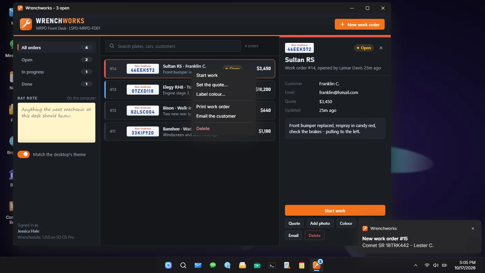

<div align="center">

# sd-computers

<a href="https://fivem.samueldev.shop/computer">
  
</a>

### Browser demo

[](https://fivem.samueldev.shop/computer)

The whole desktop runs here with sample data, in all three looks, and so does the admin panel. Sign in, open the apps, write a document, play a hacking minigame. Nothing to install.

<sub>[fivem.samueldev.shop/computer](https://fivem.samueldev.shop/computer)</sub>

<a href="https://fivem.samueldev.shop/computer">
  
</a>

---

sd-computers puts a working desktop on any computer in your city. Players walk up to a prop or a place, sign in and use real apps: Mail, a document editor that prints to paper, a browser for the city's own sites, banking, a job's notice board and boss menu, security cameras, that machine's own logs, and a Command Prompt that launches hacking minigames. It runs on QBOX and QBCORE, and on ESX without the Business Manager.

Every computer opens in one of three original looks, picked per computer: a current desktop, a 1991 one inside a CRT, and one with a dock and a menu bar. Admins place computers, security cameras and printers in game with `/computeradmin`, without touching a config file.

The screen on the prop is real too. Sit down at a computer and the camera goes up to it: the desktop is inside the prop's own bezel, with the room still there around it. A computer nobody is using shows its lock screen, and one somebody is using shows what they are doing, live, to anyone standing nearby.

So is the paper. A page waits in the printer's tray, is taken as an item, and opens as a sheet of A4 that can be handed to somebody else and signed.

[](https://github.com/Samuels-Development/sd-computers)
[](https://discord.gg/FzPehMQaBQ)
[](https://docs.samueldev.shop/resources/computers/)


[**Live demo**](https://fivem.samueldev.shop/computer) · [**Documentation**](https://docs.samueldev.shop/resources/computers/) · [**Store**](https://fivem.samueldev.shop) · [**Discord**](https://discord.gg/FzPehMQaBQ)

**Works together:** [**sd-phone**](https://github.com/Samuels-Development/sd-phone) · [**sd-tablet**](https://github.com/Samuels-Development/sd-tablet) · **sd-computers**

</div>

---

## Support Me

If you're enjoying sd-computers and want to support my work, consider picking up a script from [Samuel's Development](https://fivem.samueldev.shop). Every purchase helps me keep building and improving resources like sd-computers. Browse Petty Crimes, Advanced Crafting, Horde, Smash Down, and more to find something for your server.

## In game

On a server, at a desk in Mission Row. Click any image for the full-size version.

<p align="center"><a href="docs/previews/ingame/desk.webp"></a></p>
<p align="center"><sub>Nobody at the desk: the monitor shows its lock screen to the room, and so does the one through the window</sub></p>

<div align="center">
<table>
  <tr>
    <td align="center" width="50%"><a href="docs/previews/ingame/signin.webp"></a><br /><sub><b>Sitting down:</b> the camera goes up to the monitor, and the desktop is inside its bezel</sub></td>
    <td align="center" width="50%"><a href="docs/previews/ingame/cameras.webp"></a><br /><sub><b>Security Cameras:</b> the station's front entrance, live</sub></td>
  </tr>
  <tr>
    <td align="center" width="50%"><a href="docs/previews/ingame/marketplace.webp"></a><br /><sub><b>Browser:</b> marketplace.ls, the phone's Marketplace as a website</sub></td>
    <td align="center" width="50%"><a href="docs/previews/ingame/printout.webp"></a><br /><sub><b>Printed:</b> a page from the printer's tray, held up to read</sub></td>
  </tr>
</table>
</div>

## See it move

Recorded from the browser demo, with sample data.

**Starting up, signing in and looking round**

<p align="center"></p>

<div align="center">
<table>
  <tr>
    <td align="center" width="50%"><br /><sub><b>Files:</b> a part in its own typeface and ink, and a line to sign on</sub></td>
    <td align="center" width="50%"><br /><sub><b>On paper:</b> the printed page in the hand, and a line of it signed</sub></td>
  </tr>
  <tr>
    <td align="center" width="50%"><br /><sub><b>SD Desktop 3.11:</b> the CRT warming up, the DOS boot, the log on box</sub></td>
    <td align="center" width="50%"><br /><sub><b>Three looks:</b> the same Mail, on the same server</sub></td>
  </tr>
</table>
</div>

## Screenshots

Captured from the browser demo using sample data. Click any image for the full-size version.

**Jump to:** [SD OS Pro](#sd-os-pro-modern) · [SD OS Harbor](#sd-os-harbor-mac) · [SD Desktop 3.11](#sd-desktop-311-retro) · [Printed pages](#printed-pages) · [Hacking minigames](#hacking-minigames) · [Admin panel](#admin-panel-computeradmin) · [Props](#props)

### SD OS Pro (`modern`)

A current desktop: centred taskbar, Start menu with search, rounded translucent windows, dark and light themes.

<p align="center"><a href="docs/previews/modern/desktop.webp"></a></p>

<div align="center">
<table>
  <tr>
    <td align="center"><a href="docs/previews/modern/mail.webp"></a><br /><sub>Mail</sub></td>
    <td align="center"><a href="docs/previews/modern/files.webp"></a><br /><sub>Files</sub></td>
    <td align="center"><a href="docs/previews/modern/browser-weazel.webp"></a><br /><sub>Weazel News</sub></td>
  </tr>
  <tr>
    <td align="center"><a href="docs/previews/modern/messages.webp"></a><br /><sub>Messages</sub></td>
    <td align="center"><a href="docs/previews/modern/bank.webp"></a><br /><sub>Bank</sub></td>
    <td align="center"><a href="docs/previews/modern/boss.webp"></a><br /><sub>Business Manager</sub></td>
  </tr>
  <tr>
    <td align="center"><a href="docs/previews/modern/photos.webp"></a><br /><sub>Photos</sub></td>
    <td align="center"><a href="docs/previews/modern/cmd.webp"></a><br /><sub>Command Prompt</sub></td>
    <td align="center"><a href="docs/previews/modern/games.webp"></a><br /><sub>Games</sub></td>
  </tr>
</table>
</div>

<details>
<summary><b>Every screen of SD OS Pro (36)</b></summary>
<br />

<div align="center">
<table>
  <tr>
    <td align="center"><a href="docs/previews/modern/lock.webp"></a><br /><sub>Lock screen</sub></td>
    <td align="center"><a href="docs/previews/modern/signin.webp"></a><br /><sub>Sign in</sub></td>
    <td align="center"><a href="docs/previews/modern/start.webp"></a><br /><sub>Start menu</sub></td>
  </tr>
  <tr>
    <td align="center"><a href="docs/previews/modern/mail.webp"></a><br /><sub>Mail</sub></td>
    <td align="center"><a href="docs/previews/modern/mail-compose.webp"></a><br /><sub>New mail</sub></td>
    <td align="center"><a href="docs/previews/modern/messages.webp"></a><br /><sub>Messages</sub></td>
  </tr>
  <tr>
    <td align="center"><a href="docs/previews/modern/notes.webp"></a><br /><sub>Notes</sub></td>
    <td align="center"><a href="docs/previews/modern/contacts.webp"></a><br /><sub>Contacts</sub></td>
    <td align="center"><a href="docs/previews/modern/photos.webp"></a><br /><sub>Photos</sub></td>
  </tr>
  <tr>
    <td align="center"><a href="docs/previews/modern/files.webp"></a><br /><sub>Files</sub></td>
    <td align="center"><a href="docs/previews/modern/print.webp"></a><br /><sub>Print</sub></td>
    <td align="center"><a href="docs/previews/modern/notepad.webp"></a><br /><sub>Notepad</sub></td>
  </tr>
  <tr>
    <td align="center"><a href="docs/previews/modern/browser.webp"></a><br /><sub>Browser</sub></td>
    <td align="center"><a href="docs/previews/modern/browser-weazel.webp"></a><br /><sub>Weazel News</sub></td>
    <td align="center"><a href="docs/previews/modern/browser-market.webp"></a><br /><sub>Marketplace</sub></td>
  </tr>
  <tr>
    <td align="center"><a href="docs/previews/modern/browser-pages.webp"></a><br /><sub>Yellow Pages</sub></td>
    <td align="center"><a href="docs/previews/modern/browser-directory.webp"></a><br /><sub>Business Directory</sub></td>
    <td align="center"><a href="docs/previews/modern/browser-squawk.webp"></a><br /><sub>Squawk</sub></td>
  </tr>
  <tr>
    <td align="center"><a href="docs/previews/modern/browser-laws.webp"></a><br /><sub>Laws and Fines</sub></td>
    <td align="center"><a href="docs/previews/modern/browser-stocks.webp"></a><br /><sub>Stock Market</sub></td>
    <td align="center"><a href="docs/previews/modern/bank.webp"></a><br /><sub>Bank</sub></td>
  </tr>
  <tr>
    <td align="center"><a href="docs/previews/modern/board.webp"></a><br /><sub>Company Board</sub></td>
    <td align="center"><a href="docs/previews/modern/cameras.webp"></a><br /><sub>Security Cameras</sub></td>
    <td align="center"><a href="docs/previews/modern/boss.webp"></a><br /><sub>Business Manager</sub></td>
  </tr>
  <tr>
    <td align="center"><a href="docs/previews/modern/boss-employees.webp"></a><br /><sub>Employees</sub></td>
    <td align="center"><a href="docs/previews/modern/boss-finances.webp"></a><br /><sub>Finances</sub></td>
    <td align="center"><a href="docs/previews/modern/logs.webp"></a><br /><sub>Event Viewer</sub></td>
  </tr>
  <tr>
    <td align="center"><a href="docs/previews/modern/cmd.webp"></a><br /><sub>Command Prompt</sub></td>
    <td align="center"><a href="docs/previews/modern/calculator.webp"></a><br /><sub>Calculator</sub></td>
    <td align="center"><a href="docs/previews/modern/settings.webp"></a><br /><sub>Settings</sub></td>
  </tr>
  <tr>
    <td align="center"><a href="docs/previews/modern/settings-personalization.webp"></a><br /><sub>Personalization</sub></td>
    <td align="center"><a href="docs/previews/modern/phonelink.webp"></a><br /><sub>Phone Link</sub></td>
    <td align="center"><a href="docs/previews/modern/games.webp"></a><br /><sub>Games</sub></td>
  </tr>
  <tr>
    <td align="center"><a href="docs/previews/modern/game-mines.webp"></a><br /><sub>Mines</sub></td>
    <td align="center"><a href="docs/previews/modern/game-solitaire.webp"></a><br /><sub>Solitaire</sub></td>
    <td align="center"><a href="docs/previews/modern/game-snake.webp"></a><br /><sub>Snake</sub></td>
  </tr>
</table>
</div>

</details>

### SD OS Harbor (`mac`)

A top menu bar, a dock that magnifies, traffic-light window buttons and a search overlay.

<p align="center"><a href="docs/previews/mac/desktop.webp"></a></p>

<div align="center">
<table>
  <tr>
    <td align="center"><a href="docs/previews/mac/lock.webp"></a><br /><sub>Lock screen</sub></td>
    <td align="center"><a href="docs/previews/mac/mail.webp"></a><br /><sub>Mail</sub></td>
    <td align="center"><a href="docs/previews/mac/files.webp"></a><br /><sub>Files</sub></td>
  </tr>
  <tr>
    <td align="center"><a href="docs/previews/mac/browser-market.webp"></a><br /><sub>Marketplace</sub></td>
    <td align="center"><a href="docs/previews/mac/messages.webp"></a><br /><sub>Messages</sub></td>
    <td align="center"><a href="docs/previews/mac/settings-personalization.webp"></a><br /><sub>Personalization</sub></td>
  </tr>
</table>
</div>

<details>
<summary><b>Every screen of SD OS Harbor (35)</b></summary>
<br />

<div align="center">
<table>
  <tr>
    <td align="center"><a href="docs/previews/mac/lock.webp"></a><br /><sub>Lock screen</sub></td>
    <td align="center"><a href="docs/previews/mac/signin.webp"></a><br /><sub>Sign in</sub></td>
    <td align="center"><a href="docs/previews/mac/mail.webp"></a><br /><sub>Mail</sub></td>
  </tr>
  <tr>
    <td align="center"><a href="docs/previews/mac/mail-compose.webp"></a><br /><sub>New mail</sub></td>
    <td align="center"><a href="docs/previews/mac/messages.webp"></a><br /><sub>Messages</sub></td>
    <td align="center"><a href="docs/previews/mac/notes.webp"></a><br /><sub>Notes</sub></td>
  </tr>
  <tr>
    <td align="center"><a href="docs/previews/mac/contacts.webp"></a><br /><sub>Contacts</sub></td>
    <td align="center"><a href="docs/previews/mac/photos.webp"></a><br /><sub>Photos</sub></td>
    <td align="center"><a href="docs/previews/mac/files.webp"></a><br /><sub>Files</sub></td>
  </tr>
  <tr>
    <td align="center"><a href="docs/previews/mac/print.webp"></a><br /><sub>Print</sub></td>
    <td align="center"><a href="docs/previews/mac/notepad.webp"></a><br /><sub>Notepad</sub></td>
    <td align="center"><a href="docs/previews/mac/browser.webp"></a><br /><sub>Browser</sub></td>
  </tr>
  <tr>
    <td align="center"><a href="docs/previews/mac/browser-weazel.webp"></a><br /><sub>Weazel News</sub></td>
    <td align="center"><a href="docs/previews/mac/browser-market.webp"></a><br /><sub>Marketplace</sub></td>
    <td align="center"><a href="docs/previews/mac/browser-pages.webp"></a><br /><sub>Yellow Pages</sub></td>
  </tr>
  <tr>
    <td align="center"><a href="docs/previews/mac/browser-directory.webp"></a><br /><sub>Business Directory</sub></td>
    <td align="center"><a href="docs/previews/mac/browser-squawk.webp"></a><br /><sub>Squawk</sub></td>
    <td align="center"><a href="docs/previews/mac/browser-laws.webp"></a><br /><sub>Laws and Fines</sub></td>
  </tr>
  <tr>
    <td align="center"><a href="docs/previews/mac/browser-stocks.webp"></a><br /><sub>Stock Market</sub></td>
    <td align="center"><a href="docs/previews/mac/bank.webp"></a><br /><sub>Bank</sub></td>
    <td align="center"><a href="docs/previews/mac/board.webp"></a><br /><sub>Company Board</sub></td>
  </tr>
  <tr>
    <td align="center"><a href="docs/previews/mac/cameras.webp"></a><br /><sub>Security Cameras</sub></td>
    <td align="center"><a href="docs/previews/mac/boss.webp"></a><br /><sub>Business Manager</sub></td>
    <td align="center"><a href="docs/previews/mac/boss-employees.webp"></a><br /><sub>Employees</sub></td>
  </tr>
  <tr>
    <td align="center"><a href="docs/previews/mac/boss-finances.webp"></a><br /><sub>Finances</sub></td>
    <td align="center"><a href="docs/previews/mac/logs.webp"></a><br /><sub>Event Viewer</sub></td>
    <td align="center"><a href="docs/previews/mac/cmd.webp"></a><br /><sub>Command Prompt</sub></td>
  </tr>
  <tr>
    <td align="center"><a href="docs/previews/mac/calculator.webp"></a><br /><sub>Calculator</sub></td>
    <td align="center"><a href="docs/previews/mac/settings.webp"></a><br /><sub>Settings</sub></td>
    <td align="center"><a href="docs/previews/mac/settings-personalization.webp"></a><br /><sub>Personalization</sub></td>
  </tr>
  <tr>
    <td align="center"><a href="docs/previews/mac/phonelink.webp"></a><br /><sub>Phone Link</sub></td>
    <td align="center"><a href="docs/previews/mac/games.webp"></a><br /><sub>Games</sub></td>
    <td align="center"><a href="docs/previews/mac/game-mines.webp"></a><br /><sub>Mines</sub></td>
  </tr>
  <tr>
    <td align="center"><a href="docs/previews/mac/game-solitaire.webp"></a><br /><sub>Solitaire</sub></td>
    <td align="center"><a href="docs/previews/mac/game-snake.webp"></a><br /><sub>Snake</sub></td>
  </tr>
</table>
</div>

</details>

### SD Desktop 3.11 (`retro`)

A 1991 shell inside a beige CRT: a DOS boot, a teal desktop and bevelled grey windows that snap open in chunky steps.

<p align="center"><a href="docs/previews/retro/desktop.webp"></a></p>

<div align="center">
<table>
  <tr>
    <td align="center"><a href="docs/previews/retro/signin.webp"></a><br /><sub>Sign in</sub></td>
    <td align="center"><a href="docs/previews/retro/mail.webp"></a><br /><sub>Mail</sub></td>
    <td align="center"><a href="docs/previews/retro/files.webp"></a><br /><sub>Files</sub></td>
  </tr>
  <tr>
    <td align="center"><a href="docs/previews/retro/browser-weazel.webp"></a><br /><sub>Weazel News</sub></td>
    <td align="center"><a href="docs/previews/retro/cmd.webp"></a><br /><sub>Command Prompt</sub></td>
    <td align="center"><a href="docs/previews/retro/game-solitaire.webp"></a><br /><sub>Solitaire</sub></td>
  </tr>
</table>
</div>

<details>
<summary><b>Every screen of SD Desktop 3.11 (34)</b></summary>
<br />

<div align="center">
<table>
  <tr>
    <td align="center"><a href="docs/previews/retro/lock.webp"></a><br /><sub>Lock screen</sub></td>
    <td align="center"><a href="docs/previews/retro/signin.webp"></a><br /><sub>Sign in</sub></td>
    <td align="center"><a href="docs/previews/retro/mail.webp"></a><br /><sub>Mail</sub></td>
  </tr>
  <tr>
    <td align="center"><a href="docs/previews/retro/messages.webp"></a><br /><sub>Messages</sub></td>
    <td align="center"><a href="docs/previews/retro/notes.webp"></a><br /><sub>Notes</sub></td>
    <td align="center"><a href="docs/previews/retro/contacts.webp"></a><br /><sub>Contacts</sub></td>
  </tr>
  <tr>
    <td align="center"><a href="docs/previews/retro/photos.webp"></a><br /><sub>Photos</sub></td>
    <td align="center"><a href="docs/previews/retro/files.webp"></a><br /><sub>Files</sub></td>
    <td align="center"><a href="docs/previews/retro/print.webp"></a><br /><sub>Print</sub></td>
  </tr>
  <tr>
    <td align="center"><a href="docs/previews/retro/notepad.webp"></a><br /><sub>Notepad</sub></td>
    <td align="center"><a href="docs/previews/retro/browser.webp"></a><br /><sub>Browser</sub></td>
    <td align="center"><a href="docs/previews/retro/browser-weazel.webp"></a><br /><sub>Weazel News</sub></td>
  </tr>
  <tr>
    <td align="center"><a href="docs/previews/retro/browser-market.webp"></a><br /><sub>Marketplace</sub></td>
    <td align="center"><a href="docs/previews/retro/browser-pages.webp"></a><br /><sub>Yellow Pages</sub></td>
    <td align="center"><a href="docs/previews/retro/browser-directory.webp"></a><br /><sub>Business Directory</sub></td>
  </tr>
  <tr>
    <td align="center"><a href="docs/previews/retro/browser-squawk.webp"></a><br /><sub>Squawk</sub></td>
    <td align="center"><a href="docs/previews/retro/browser-laws.webp"></a><br /><sub>Laws and Fines</sub></td>
    <td align="center"><a href="docs/previews/retro/browser-stocks.webp"></a><br /><sub>Stock Market</sub></td>
  </tr>
  <tr>
    <td align="center"><a href="docs/previews/retro/bank.webp"></a><br /><sub>Bank</sub></td>
    <td align="center"><a href="docs/previews/retro/board.webp"></a><br /><sub>Company Board</sub></td>
    <td align="center"><a href="docs/previews/retro/cameras.webp"></a><br /><sub>Security Cameras</sub></td>
  </tr>
  <tr>
    <td align="center"><a href="docs/previews/retro/boss.webp"></a><br /><sub>Business Manager</sub></td>
    <td align="center"><a href="docs/previews/retro/boss-employees.webp"></a><br /><sub>Employees</sub></td>
    <td align="center"><a href="docs/previews/retro/boss-finances.webp"></a><br /><sub>Finances</sub></td>
  </tr>
  <tr>
    <td align="center"><a href="docs/previews/retro/logs.webp"></a><br /><sub>Event Viewer</sub></td>
    <td align="center"><a href="docs/previews/retro/cmd.webp"></a><br /><sub>Command Prompt</sub></td>
    <td align="center"><a href="docs/previews/retro/calculator.webp"></a><br /><sub>Calculator</sub></td>
  </tr>
  <tr>
    <td align="center"><a href="docs/previews/retro/settings.webp"></a><br /><sub>Settings</sub></td>
    <td align="center"><a href="docs/previews/retro/settings-personalization.webp"></a><br /><sub>Personalization</sub></td>
    <td align="center"><a href="docs/previews/retro/phonelink.webp"></a><br /><sub>Phone Link</sub></td>
  </tr>
  <tr>
    <td align="center"><a href="docs/previews/retro/games.webp"></a><br /><sub>Games</sub></td>
    <td align="center"><a href="docs/previews/retro/game-mines.webp"></a><br /><sub>Mines</sub></td>
    <td align="center"><a href="docs/previews/retro/game-solitaire.webp"></a><br /><sub>Solitaire</sub></td>
  </tr>
  <tr>
    <td align="center"><a href="docs/previews/retro/game-snake.webp"></a><br /><sub>Snake</sub></td>
  </tr>
</table>
</div>

</details>

### Printed pages

What a printout opens as: a sheet of A4 held up over the game, that leans with the mouse and turns like a page. A document prints the way it was set, and its lines to sign on are signed here, by whoever holds the page.

<div align="center">
<table>
  <tr>
    <td align="center"><a href="docs/previews/paper/document.webp"></a><br /><sub>A document from Files</sub></td>
    <td align="center"><a href="docs/previews/paper/contract.webp"></a><br /><sub>A signed contract</sub></td>
    <td align="center"><a href="docs/previews/paper/statement.webp"></a><br /><sub>Bank statement</sub></td>
    <td align="center"><a href="docs/previews/paper/logs.webp"></a><br /><sub>System log</sub></td>
  </tr>
</table>
</div>

### Hacking minigames

Ten minigames, launched from Command Prompt or from your own scripts. Shown here in SD OS Pro; the games are the same in every look.

<div align="center">
<table>
  <tr>
    <td align="center"><a href="docs/previews/hacking/maze.webp"></a><br /><sub>Network Maze</sub></td>
    <td align="center"><a href="docs/previews/hacking/capture.webp"></a><br /><sub>Node Capture</sub></td>
    <td align="center"><a href="docs/previews/hacking/cipher.webp"></a><br /><sub>Cipher Lock</sub></td>
  </tr>
  <tr>
    <td align="center"><a href="docs/previews/hacking/snake.webp"></a><br /><sub>Data Worm</sub></td>
    <td align="center"><a href="docs/previews/hacking/firewall.webp"></a><br /><sub>Firewall Defense</sub></td>
    <td align="center"><a href="docs/previews/hacking/evasion.webp"></a><br /><sub>Highway Evasion</sub></td>
  </tr>
  <tr>
    <td align="center"><a href="docs/previews/hacking/typing.webp"></a><br /><sub>Code Injection</sub></td>
    <td align="center"><a href="docs/previews/hacking/signal.webp"></a><br /><sub>Signal Replay</sub></td>
    <td align="center"><a href="docs/previews/hacking/pipe.webp"></a><br /><sub>Packet Routing</sub></td>
  </tr>
  <tr>
    <td align="center"><a href="docs/previews/hacking/breakout.webp"></a><br /><sub>ICE Breaker</sub></td>
    <td align="center"><a href="docs/previews/hacking/programs.webp"></a><br /><sub>Program list</sub></td>
    <td align="center"><a href="docs/previews/hacking/standalone.webp"></a><br /><sub>Standalone window</sub></td>
  </tr>
</table>
</div>

### Admin panel (`/computeradmin`)

Every computer, security camera and printer on the server, and the tools that place new ones.

<p align="center"><a href="docs/previews/admin/computers.webp"></a></p>

<div align="center">
<table>
  <tr>
    <td align="center"><a href="docs/previews/admin/overview.webp"></a><br /><sub>Overview</sub></td>
    <td align="center"><a href="docs/previews/admin/cameras.webp"></a><br /><sub>Cameras</sub></td>
    <td align="center"><a href="docs/previews/admin/printers.webp"></a><br /><sub>Printers</sub></td>
  </tr>
  <tr>
    <td align="center"><a href="docs/previews/admin/automatic.webp"></a><br /><sub>Automatic</sub></td>
    <td align="center"><a href="docs/previews/admin/props.webp"></a><br /><sub>Props</sub></td>
    <td align="center"><a href="docs/previews/admin/styles.webp"></a><br /><sub>Styles</sub></td>
  </tr>
</table>
</div>

### Props

A computer can be placed as, or picked from the world as, a monitor, a laptop or a tower PC, and a printer as a printer or a photocopier. Towers are off out of the box: they have no screen, so they open fullscreen. Add any streamed prop from the admin panel, or in `configs/shared/admin.lua`. Every prop, photographed in game, is in the docs under [props and screens](https://docs.samueldev.shop/resources/computers/props-screens).

<div align="center">
<table>
  <tr>
    <td align="center" width="200"><br /><sub><b>Flat monitor</b><br /><code>prop_monitor_01a</code></sub></td>
    <td align="center" width="200"><br /><sub><b>CRT monitor</b><br /><code>prop_monitor_03b</code></sub></td>
    <td align="center" width="200"><br /><sub><b>Laptop</b><br /><code>prop_laptop_01a</code></sub></td>
    <td align="center" width="200"><br /><sub><b>Laser printer</b><br /><code>prop_printer_01</code></sub></td>
  </tr>
</table>
</div>

---

> [!TIP]
> **Running [sd-phone](https://github.com/Samuels-Development/sd-phone) v1.0.7 or newer? The computers pick it up.**
> A computer becomes another screen for the character's phone: Mail switches to the phone's own
> mailboxes, three more apps appear (Messages, Notes and Contacts), and Files, Photos and Bank show
> the phone's documents, gallery and banking history. Players link their phone to a machine with a code
> from the Phone Link app, and the Browser shows the city's own sites live. sd-computers is complete without it.
> [More in the docs](https://docs.samueldev.shop/resources/computers/phone-link).

## Apps

| | |
|---|---|
| **Mail** | Shared, password-protected `@lsmail.com` accounts (sign up, sign in, multiple accounts), inbox, flagged, drafts, sent, bin, reply and forward, bounces for unknown addresses, live new-mail toasts |
| **Event Viewer** | That computer's System Logs: sign-ins and failed PINs, lockouts, apps opened, mail sent, Business Manager actions, hack attempts and breaches, plus anything other resources write. Filterable; clearing it leaves a "log was cleared by X" entry (event 1102) |
| **Command Prompt** | A real-feeling `cmd.exe` (`ipconfig`, `systeminfo`, `ping`, `tasklist` and more) that launches the hacking minigames: free practice (`hack maze hard`) and configured breach targets (`targets`, `breach fleeca-ledger`) that pay rewards server-side |
| **Business Manager** | The boss menu: roster with online and on-duty status, promote, demote and fire, hire the players standing at the computer or anyone online by their player ID (they get an accept prompt either way), society balance chart, deposit and withdraw, statement. Only shown to that job's bosses |
| **Files** | The character's documents, written in a proper editor: a typeface for the page, and a typeface, size and ink of its own for any part of it; headings, lists, quotes, bold and the rest, alignment, rules, pictures out of Photos with a size, a side and a caption, and lines to sign on. They follow the character to every computer and print the way they are set. With sd-phone, the phone's documents show beside them |
| **Photos** | The character's pictures: added by their link, they follow the character to every computer, and they are what Files puts into a document. With sd-phone, the phone's gallery shows beside them once the phone is linked |
| **Browser** | A closed, in-game network: the sites you list. With sd-phone those are the city's own, live: Weazel News, the Marketplace, the Yellow Pages, a business directory, Squawk, the penal code and the stock market. You can also write pages right in the config, or embed your own web page. Any other address "can't be reached" |
| **Bank** | The character's bank balance, cash and recent transactions, to look at. Nothing can be moved from it |
| **Company Board** | A job's notice board: bosses post, pin and remove announcements, everyone in the job reads them from any computer, and it shows who is on duty. Only shown to players with a job |
| **Security Cameras** | The cameras a player is allowed to watch from that computer. Picking one plays its picture live in the app's window, to look around and zoom with, and **Full screen** puts it over the whole display. Only shown to players with at least one camera to watch; every first look is written to the System Logs |
| **Print** | Notepad, Files, Mail, Bank and Event Viewer print to a [printer](#printers) near the computer. The page waits in the printer's tray and is taken as an item that opens as the sheet of A4 it is |
| **Games** | A shelf of three, each one a program of its own with its own window, icon and look: Mines on a bomb-disposal console, Solitaire on a felt card table, Snake on an arcade screen. Best results are kept |
| **Phone Link** | Only with sd-phone: links the character's phone to that machine. It sends a code to the phone as a notification; typing it in puts the phone's apps on the desktop there and then, until they unlink it |
| **Messages / Notes / Contacts** | Only with sd-phone, once the phone is linked in Phone Link: the phone's texts, notes and address book on the desktop |
| **Notepad / Calculator / Settings** | Notes that follow the character to every computer; a full standard calculator; wallpaper, accent colour and dark or light mode, saved per character |

Around the apps: a lock screen with an optional per-computer PIN (checked server-side, with lockout), welcome and shutdown screens, draggable, resizable, snap-to-maximize windows, calendar and quick-settings flyouts, toast notifications, and system sounds for starting up, signing in, windows, clicks and notifications (synthesized, no audio files; each style has its own and can switch them off).

## Three looks, one computer

Every computer runs the same apps against the same server. Its **style** decides the shell around them:

| Style | Name on screen | Feel |
|---|---|---|
| `modern` | SD OS Pro | Centred taskbar and Start menu, rounded translucent windows, dark or light, soft glassy system sounds |
| `retro` | SD Desktop 3.11 | A 1991 shell inside a beige CRT: DOS boot, teal desktop, bevelled grey windows that snap open in chunky steps, synthesized period sounds |
| `mac` | SD OS Harbor | Top menu bar, magnifying dock, traffic-light window buttons, search overlay, a startup chord and its own pops and whooshes |

The style is picked per computer, and every character's wallpaper, accent and light or dark choice is saved per style. All three are original designs: no real OS logos, names, wallpapers or fonts.

## At the screen, and on it

Using a computer does not cover the game with a desktop. The camera moves up to the prop, square on to its screen, and the desktop sits exactly inside it, with the room still there around it. Out in the world, a computer nobody is using shows its lock screen on the prop, and one somebody is using shows a live copy of what they are doing to anyone standing nearby (PIN and password fields masked). Any prop can be given a screen: the admin panel has a tool that draws it on the prop with the mouse. [Props and screens in the docs](https://docs.samueldev.shop/resources/computers/props-screens).

## Hacking

Command Prompt launches ten minigames from sd-deaddrop, with the same server-side anti-cheat: proof-of-play floors, ordered milestones and server-seeded puzzles. `hack` runs a practice game; `breach` runs a target you set up in `configs/server/targets.lua`, with its minigame steps, item requirement, cooldowns, police alert and a reward the server pays (items, money, mail or your own event). Your own robberies and heists can put the same minigames in front of a door or a vault, with a result the server has verified. [Hacking](https://docs.samueldev.shop/resources/computers/hacking) and [hacks in your scripts](https://docs.samueldev.shop/resources/computers/hacks-in-scripts) in the docs.

## Admin panel

`/computeradmin` lists every computer, security camera and printer on the server, with who is sitting at which, and places new ones in game without touching a config file: stand a prop with the placement gizmo, or turn a monitor or printer the game already has into one. Cameras are put up by flying a camera to where it hangs. The same panel switches the monitors and laptops around the map on and off as computers, model by model, and adds props of your own. [The admin panel in the docs](https://docs.samueldev.shop/resources/computers/admin-panel).

## Printers

A page is not handed to whoever pressed Print: it comes out of a printer in the world and waits in its tray until somebody takes it. A printout is one inventory item, a sheet of A4 that can be read, handed over, stashed and signed by whoever holds it, with the name and time under each signature written by the server. Mail, bank statements and logs are built by the server from its own data, so nobody can print a statement the bank does not agree with. [Printers in the docs](https://docs.samueldev.shop/resources/computers/printers).

## Custom apps

Your own resource can put a program on the desktop. Register it from your server and it gets an icon, a window, a taskbar or dock entry and a count badge in all three looks; its page talks to your server, your client script and the OS through a small API: the desktop's own dialogs and context menus, notifications, printing to a printer in the room, storage per character or per computer, opening Mail or the Browser, and lines in the Event Viewer. Your endpoints only ever run for a player signed in at a computer that has your app.

```lua
exports['sd-computers']:AddCustomApp({
    id = 'wrenchworks',
    label = 'Wrenchworks',
    ui = 'wrenchworks/web/index.html',
    icon = 'wrenchworks/web/icon.svg',
    groups = { mechanic = 0 },
    endpoints = {
        ['orders:list'] = function(source, data, ctx) return { orders = orders } end,
    },
})
```

<p align="center"></p>

`examples/wrenchworks` is a complete one, a garage's work-order book in plain HTML and JavaScript that uses every call: copy it, rename it, keep what you need. [Custom apps in the docs](https://docs.samueldev.shop/resources/computers/custom-apps).

## Documentation

Everything else is on the docs site, **[docs.samueldev.shop/resources/computers](https://docs.samueldev.shop/resources/computers/)**:

| Page | What is on it |
|---|---|
| [Installation](https://docs.samueldev.shop/resources/computers/installation) | Dependencies, the printout item for your inventory, setting up computers, breach targets, PINs and admin permissions |
| [Configuration](https://docs.samueldev.shop/resources/computers/configuration) | Every setting in every config file, and the [full default files](https://docs.samueldev.shop/resources/computers/full-config) |
| [Admin Panel](https://docs.samueldev.shop/resources/computers/admin-panel) | Placing computers, cameras and printers, picking props from the world, automatic computers, permissions |
| [Props & Screens](https://docs.samueldev.shop/resources/computers/props-screens) | Every prop, adding your own, the screen on the prop, drawing a prop's screen |
| [Printers](https://docs.samueldev.shop/resources/computers/printers) | Printing, trays, the printed page, signing |
| [Hacking & Breach Targets](https://docs.samueldev.shop/resources/computers/hacking) | Command Prompt, the minigames, breach targets and rewards, the anti-cheat |
| [Hacks in Your Scripts](https://docs.samueldev.shop/resources/computers/hacks-in-scripts) | Putting the minigames into your own robberies: from the server, from the client with a proof, or at a computer |
| [Browser Sites](https://docs.samueldev.shop/resources/computers/browser) | sd-phone's sites live, pages written in the config, your own web pages |
| [sd-phone Link](https://docs.samueldev.shop/resources/computers/phone-link) | What changes with sd-phone, and linking a phone to a machine |
| [Security](https://docs.samueldev.shop/resources/computers/security) | How the server keeps a modified client from doing what a player at the desk could not |
| [Custom Apps](https://docs.samueldev.shop/resources/computers/custom-apps) | Your own programs on the desktop: registering one, the page's API, endpoints, printing, storage, the example app |
| [Client Exports](https://docs.samueldev.shop/resources/computers/exports-client) / [Server Exports](https://docs.samueldev.shop/resources/computers/exports-server) | Opening computers from other scripts, verified hacks, System Logs, mail, printing your own pages, the breach event |

## Compatibility

| Layer | Supported |
|---|---|
| Frameworks | QBox, QBCore. ESX works for everything except the Business Manager, which hides itself |
| Target | ox_target, qb-target, qtarget |
| Society funds | sd-banking, Renewed-Banking (optional; the Finances tab hides without one) |
| Phone | sd-phone v1.0.7 or newer (optional) |

## Installation

Download **`sd-computers.zip`** from the [latest release](https://github.com/Samuels-Development/sd-computers/releases/latest) and unzip it into your resources folder: it is the resource with its UI already built, ready to drop in.

> [!IMPORTANT]
> Download the `sd-computers.zip` asset, not **Source code (zip)** or the green **Code** button. Those are the source, without the built UI: the computer would open to a blank screen until you [build it yourself](#building-from-source).

It needs [ox_lib](https://github.com/CommunityOx/ox_lib), [oxmysql](https://github.com/CommunityOx/oxmysql) and a target resource (`ox_target`, `qb-target` or `qtarget`). Start it after them, your framework and your banking:

```cfg
ensure ox_lib
ensure oxmysql
ensure sd-computers
```

The database tables create themselves on first start. Then add the `printed_document` item to your inventory (the picture is in `docs/items/`) and set up your computers: the full guide is **[Installation in the docs](https://docs.samueldev.shop/resources/computers/installation)**.

## Controls

| Key | What it does |
|---|---|
| <kbd>Esc</kbd> | On the lock screen or an empty desktop, stands you up |
| <kbd>Ctrl</kbd> + <kbd>Esc</kbd> | Opens Start |
| <kbd>Alt</kbd> + <kbd>F4</kbd> | Closes the focused window |

Start > Power > Shut down stands you up too, with the shutdown screen. Walking away closes the computer.

## Building from source

The repository is the source: the built UI (`web/build`) is not committed, and each [release](https://github.com/Samuels-Development/sd-computers/releases) builds it into its zip. To run a clone, or to change the UI, build it with Node.js (LTS):

```bash
cd web
npm install
npm run build
```

A source ZIP unpacks to `sd-computers-main`: rename the folder to `sd-computers`, the name its exports are called by. After changing the UI, run `npm run build` again; the game loads `web/build`, not the source.

`npm run dev` opens the whole OS in a browser with mock data (dev PIN `1031`). Hashes: `#desktop` skips the lock screen, `#mail` / `#boss` / `#logs` / `#cmd` and so on open an app (`#ext:wrenchworks` opens the example custom app), `#lib` shows a standalone StartHack window, and `?style=retro` or `?style=mac` switches the look. `?frame=0.2,0.1,0.6,0.78` (left, top, width, height as fractions of the window) lays the desktop out as it sits on a prop's screen. The admin panel is a page of its own: `http://localhost:<port>/admin.html` shows it with mock computers (placing "runs the gizmo" by hiding the panel for a moment). So is a prop's screen: `/screen.html?mode=idle&style=retro` is a lock face, and `/screen.html?mode=live` in a second tab shows a live copy of the OS running in the first. App contracts and UI conventions are in `web/FRONTEND.md`.
